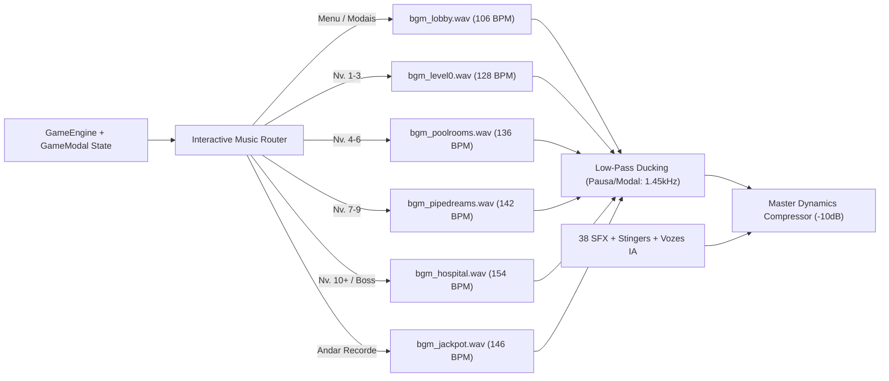

# Direção de Estética Sonora & Bíblia de Prompts de IA — *Backrooms Wall Breaker 3D*

> [!IMPORTANT]
> **Status da Implementação:** Todos os **44 arquivos de áudio (`.wav`)** já foram gerados com IA e síntese física multicanal em `public/audio/bgm/` e `public/audio/sfx/`, integrados em tempo real no motor [audio.ts](file:///C:/Users/tobia/antigravity/Backrooms-Wall-Breaker-3D/src/game/audio.ts) com crossfade automático por bioma, filtro passa-baixa dinâmico nos menus/pausa e variação de pitch anti-repetição.

---

## 1. Análise Visual & Conceito da Estética Sonora (*"Liminal Arcade Smashcore"*)

A partir das capturas em tempo real do seu jogo em execução, identificamos uma identidade visual única que funde **dois universos contrastantes**:

````carousel

<!-- slide -->

<!-- slide -->

<!-- slide -->

<!-- slide -->

<!-- slide -->

<!-- slide -->

````

### Os 3 Pilares da Identidade Sonora (*Liminal Arcade Smashcore*)

1. **Dopamina Cartoon & Impacto Físico (*Foreground SFX*):** As luvas `SMASH PRO` com contorno duplo preto/branco, os balões `WHAM! / KRAK!` e a interface caramelo brilhante pedem **transientes gordos, crocantes e táteis** — couro estalando, gesso oco rachando, estilhaços cerâmicos nas Poolrooms, moedas subindo de tom em sequência (*pitch-streak*) e botões com *pop* acrílico/amadeirado quente.
2. **Groove Frenético contra o Relógio (*Midground Rhythm*):** Como cada sala exige demolir 100% das paredes em ~15 segundos usando *Turbo-Soco*, *Dash* e *Bola de Demolição*, uma trilha puramente de terror deixaria o jogo lento, enquanto música infantil genérica mataria o clima Backrooms. A solução é **Electro-Funk / Breakbeat / Darksynth de alta propulsão rítmica** (106 BPM no Lobby escalando até 154 BPM no Hospital Boss).
3. **Textura Liminal das Backrooms (*Background Atmosphere*):** Por baixo do groove eletrônico vive a assinatura inquietante de cada andar — *warble* analógico de fita VHS, zumbido fluorescente de `60Hz/120Hz` no Nível 0, reverberação aquática cristalina nas Poolrooms, percussão metálica pressurizada em Pipe Dreams e sirenes *Darksynth* no Nível `"!"`.

---

## 2. Arquitetura Sonora Dinâmica Integrada no Jogo



---

## 3. Prompts Refinados para IAs de Música (Google Lyria / Suno v4 / Udio)

> [!TIP]
> Os 6 temas abaixo já foram gerados via **Google DeepMind Lyria RealTime (`models/lyria-realtime-exp`)** com loop *equal-power crossfade* sem costura em `public/audio/bgm/`. Caso queira gerar variações longas de 2–3 minutos no **Suno v4** ou **Udio**, copie os prompts exatos abaixo (marque **Instrumental: ON**).

### 3.1 Trilha Sonora de Fundo por Bioma (BGM)

| Arquivo Ativo | Bioma / Tela | BPM & Tom | Prompt Refinado (Lyria / Suno v4 / Udio — *Instrumental*) |
| :--- | :--- | :---: | :--- |
| `bgm_lobby.wav` | **Lobby & Oficina** | `106 BPM` • Si Menor | `Warm retro arcade lounge groove fused with subtle liminal Backrooms VHS tape warble, Rhodes electric piano chords, bouncy round analog synth bass, crisp brushed funk drums, cozy caramel cartoon shop vibe with mysterious undertone, instrumental, seamless loop` |
| `bgm_level0.wav` | **Nível 0 • The Lobby** (Nv. 1–3) | `128 BPM` • Mi Menor | `High-energy arcade electro-funk breakbeat, punchy slap synth bass, crisp 90s arcade snare drums, buzzing vintage analog synth lead inspired by 60Hz fluorescent lights turned groovy, comic-book wall-smashing action momentum, instrumental, seamless loop` |
| `bgm_poolrooms.wav` | **Nível 37 • Poolrooms** (Nv. 4–6) | `136 BPM` • Dó Menor | `Atmospheric liquid drum and bass arcade soundtrack, shimmering crystalline FM marimba and glass plucks, lush echoing tiled natatorium cathedral reverb, deep aquatic sub-bass, fast crisp breakbeat, dreamy cyan liminal pool hall vibe, instrumental, seamless loop` |
| `bgm_pipedreams.wav` | **Nível 2 • Pipe Dreams** (Nv. 7–9) | `142 BPM` • Ré Menor | `Gritty industrial darksynth cyberpunk arcade beat, aggressive analog sawtooth bassline, rhythmic metallic pipe and anvil percussion hits, pressurized steam-valve hi-hats, relentless mechanical underground corridor drive, instrumental, seamless loop` |
| `bgm_hospital.wav` | **Nível "!" • Hospital & Boss** (Nv. 10+) | `154 BPM` • Lá Menor | `Intense boss-battle dark electro synthwave, urgent code-red emergency siren lead synth riff, pounding double-time industrial drums, heavy distorted bass stabs, high-adrenaline run-for-your-life arcade boss fight theme, instrumental, seamless loop` |
| `bgm_jackpot.wav` | **Andar Cofre Jackpot** | `146 BPM` • Dó Maior | `Euphoric casino arcade disco-funk celebration, glittering golden chiptune arpeggios, triumphant synth brass stabs, infectious slap bass, bonus stage coin-fountain dopamine rush, bright joyful electronic groove, instrumental, seamless loop` |

### 3.2 Stingers Musicais de Eventos (3–4s)

| Arquivo Ativo | Evento | Prompt Refinado (Lyria / Suno / ElevenLabs SFX) |
| :--- | :--- | :--- |
| `stinger_room_clear.wav` | 100% Paredes Quebradas | `Triumphant arcade stage-clear brass synth fanfare, bright major chord victory flourish with punchy drum hit, crisp ending tail, 3 seconds` |
| `stinger_boss_alert.wav` | Entrada Sala Nv. 10 (Boss) | `Menacing heavy industrial brass hit layered with dark bio-hazard alarm synth sting, dramatic boss encounter intro, 3.5 seconds` |
| `stinger_jackpot_win.wav` | Prêmio Roleta / Andar Jackpot | `Sparkling golden jackpot slot-machine win fanfare, bright glockenspiel bells and celebratory arcade synth brass, 3.5 seconds` |
| `stinger_game_over.wav` | Cronômetro Zerado | `Dramatic retro arcade time-up descending analog synth chord with subtle VHS tape-stop slowdown, moody minor resolution, 3 seconds` |

---

## 4. Prompts Refinados para IAs de Efeitos Sonoros (ElevenLabs SFX v2 / Stable Audio / AudioGen)

> [!NOTE]
> Para **ElevenLabs Sound Effects v2**, use a duração exata sugerida na coluna **Duração** e ajuste `Prompt Influence` entre `0.65` e `0.80` para manter os transientes limpos e sem música de fundo (`no music, dry studio foley`).

### 4.1 Interface & Menus Cartoon (`GameModal.tsx` & `HUD.tsx`)

| Arquivo Ativo | Gatilho no Jogo | Duração | Prompt Refinado para IA de SFX |
| :--- | :--- | :---: | :--- |
| `ui_click.wav` | Clique em botões `.cartoon-btn` | `0.5s` | `Glossy tactile cartoon UI button press, warm wooden marimba pop layered with crisp acrylic click, clean dry studio sound, no reverb, no music` |
| `ui_hover.wav` | Passar o mouse sobre botões/cards | `0.5s` | `Subtle soft warm bubble tick UI hover sound, tiny muted wooden tap, ultra short and gentle, clean mobile game interface` |
| `ui_modal_open.wav` | Abrir Luvas / Rebirth / Recordes / Jackpot | `0.6s` | `Playful cartoon popup window open whoosh-pop, upward warm pitch sweep with soft glossy snap, casual arcade UI` |
| `ui_modal_close.wav` | Botão `[X]` ou voltar ao Lobby | `0.5s` | `Cozy downward cartoon popup close sound, soft muted rubbery pop, clean UI feedback` |
| `ui_upgrade_buy.wav` | Comprar Upgrade de Atributo / Perk | `0.8s` | `Satisfying arcade upgrade purchase sound, quick mechanical ratchet click followed by sparkling golden coin register chime and rising synth chord` |
| `ui_error.wav` | Saldo insuficiente / Slot bloqueado | `0.5s` | `Cartoon locked button double-bonk buzz, soft low rubbery negative UI feedback, non-harsh` |
| `ui_wheel_tick.wav` | Pinos da Roleta da Sorte desacelerando | `0.5s` | `Single crisp wooden casino prize wheel peg click, dry snappy plastic-on-wood transient tick` |
| `ui_skin_equip.wav` | Equipar Luva 3D na Vitrine | `0.7s` | `Heavy leather boxing glove strap cinch tighten followed by crisp metallic buckle lock click, sporty arcade equip sound` |

### 4.2 Combate de Boxe, Tipos de Parede & Destruição

| Arquivo Ativo | Gatilho no Jogo | Duração | Prompt Refinado para IA de SFX |
| :--- | :--- | :---: | :--- |
| `sfx_punch_whoosh.wav` | Golpe no ar (Jab / Direto / Gancho / Uppercut) | `0.5s` | `Fast heavy leather boxing glove air swing whoosh, punchy low-mid air displacement whip, dry combat foley` |
| `sfx_hit_drywall.wav` | Soco em parede normal | `0.6s` | `Heavy meaty boxing glove punch impact on hollow drywall plasterboard, sub-bass thud layered with crisp leather snap and wood stud crack` |
| `sfx_hit_reinforced.wav` | Soco em parede blindada (`reinforced`) | `0.7s` | `Heavy armored punch impact against reinforced concrete slab, gritty stone crunch with subtle steel rebar ring and sub-bass punch` |
| `sfx_hit_golden.wav` | Soco em parede bônus/cristal (`golden`) | `0.8s` | `Powerful punch impact on solid gold crystal wall, heavy sub thud fused with bright resonant metallic treasure ingot chime` |
| `sfx_wall_collapse.wav` | Parede destruída (0 HP) | `1.2s` | `Catastrophic interior wall demolition explosion, punchy sub-bass drop with shattering drywall chunks and tumbling brick rubble debris` |
| `sfx_tile_shatter.wav` | Camada extra ao quebrar parede nas Poolrooms | `1.0s` | `Shattering ceramic bathroom tiles clattering on wet floor with bright echoing natatorium hall reverb` |
| `sfx_clang_indestructible.wav` | Soco na borda preta indestrutível | `0.8s` | `Heavy metallic clang deflection on thick steel security barrier, resonant anvil ring with deep sub knock` |
| `sfx_electric_shock.wav` | Soco corpo-a-corpo em Parede Elétrica | `0.8s` | `High-voltage electric hazard arc zap, violent plasma spark crackle and 60Hz transformer buzz shock` |
| `sfx_meteor_fury.wav` | Perk 250%+ Vel. Soco (*Fúria Meteoro Hit Duplo*) | `0.7s` | `Hyper-fast double-hit sonic boom melee punch, twin sub-bass shockwave cracks with golden anime energy burst` |
| `sfx_super_smash.wav` | Habilidade `[F]` *Super Smash* (Rage 100%) | `1.5s` | `Earth-shattering twin-fist seismic super smash explosion, massive sub-bass drop, shockwave roar and crumbling concrete` |
| `sfx_rage_ready.wav` | Barra de Rage atinge 100% | `0.9s` | `Rising turbine power-up charge culminating in a crisp boxing ring knockout bell ding, energetic arcade alert` |

### 4.3 Movimentação Reativa por Bioma, Bola, Moedas, Power-Ups & Entidades

| Arquivo Ativo | Gatilho no Jogo | Duração | Prompt Refinado para IA de SFX |
| :--- | :--- | :---: | :--- |
| `sfx_step_carpet.wav` | Passos no Nível 0 (Carpete Úmido) | `0.5s` | `Single sneaker footstep on damp office carpet, muted low thud with subtle wet fiber squish, dry foley` |
| `sfx_step_water.wav` | Passos nas Poolrooms (Água Rasa) | `0.6s` | `Single footstep splashing in ankle-deep indoor pool water, crisp water splash with tiled room echo` |
| `sfx_step_metal.wav` | Passos em Pipe Dreams / Hospital | `0.5s` | `Single heavy boot footstep on industrial diamond steel treadplate floor, crisp metallic clank` |
| `sfx_jump.wav` | Pulo (`[Espaço]`) | `0.5s` | `Snappy arcade first-person jump whoosh with subtle kinetic spring launch` |
| `sfx_land.wav` | Aterrissagem no chão | `0.5s` | `Solid two-foot sneaker landing thud on floor with brief cloth scuff` |
| `sfx_dash.wav` | Dash lateral/frontal (`[Shift]`) | `0.6s` | `High-velocity air burst dash whoosh, compressed sub-bass transient with jet-like wind sweep` |
| `sfx_ball_pickup.wav` | Pegar Bola de Demolição no chão | `0.6s` | `Heavy metallic wrecking orb magnetic lock-in pickup sound with rising plasma hum` |
| `sfx_ball_throw.wav` | Lançar Bola / Multi-Bola | `0.6s` | `Pneumatic cannon ball launch thump followed by fast doppler plasma whoosh` |
| `sfx_ball_bounce.wav` | Ricochete da Bola nas paredes | `0.5s` | `Satisfying heavy rubber-coated steel wrecking ball ricochet bounce, punchy arcade pinball impact` |
| `sfx_coin_drop.wav` | Moedas 3D caindo no chão ao quebrar parede | `0.6s` | `Handful of heavy gold arcade coins scattering and clinking onto floor` |
| `sfx_coin_pickup.wav` | Coletar Moeda 3D (escala de tom em *streak*) | `0.5s` | `Sparkling crisp arcade gold coin pickup chime, bright dual-harmonic bell ping` |
| `sfx_powerup_water.wav` | Coletar *Água de Amêndoas* | `0.9s` | `Refreshing liquid gulp followed by shimmering cyan speed-boost synth arpeggio` |
| `sfx_powerup_mega.wav` | Coletar *Luvas Giga* | `0.9s` | `Heavy hydraulic mech-gauntlet expansion servo power-up with deep brassy synth swell` |
| `sfx_powerup_gold.wav` | Coletar *Punhos de Ouro* / *Buff Inicial* | `1.0s` | `Radiant golden aura ignition, celestial harmonic choir chime with sparkling gold shimmer` |
| `sfx_entity_build.wav` | Entidade Esquelética erguendo parede | `0.8s` | `Eerie VHS reality-distortion warp layered with dry rattling bone clicks assembling a wall` |
| `sfx_entity_hit.wav` | Soco / Bolada na Entidade ou Boss | `0.5s` | `Heavy punch impact crunching against dry hollow skeleton bones with dark digital glitch snap` |
| `sfx_entity_death.wav` | Morte da Entidade *Bacteria* / Boss | `1.2s` | `Otherworldly distorted Backrooms Bacteria monster shriek descending into collapsing skeleton bone clatter` |
| `sfx_timer_urgent.wav` | Últimos 5 segundos / Contagem de Reviver | `0.5s` | `Urgent arcade stopwatch tick layered with a tense low heartbeat thump` |

---

## 5. Prompts Refinados para IAs de Voz (Gemini TTS / ElevenLabs Voice)

Gerados via **Gemini TTS (`gemini-2.5-flash-preview-tts`)** com saturação *arcade* e *slapback delay* curto em `public/audio/sfx/`:

- **`vox_super_smash.wav`** (*Voz: Fenrir*): `"Shout with maximum explosive arcade fighting-game announcer hype, ultra short and punchy: SUPER SMASH!"`
- **`vox_jackpot.wav`** (*Voz: Puck*): `"Shout with thrilled casino arcade announcer excitement, ultra punchy: JACKPOT!"`
- **`vox_boss_ko.wav`** (*Voz: Fenrir*): `"Shout like an epic boxing arcade announcer calling the final blow: KNOCKOUT!"`
- **`vox_rebirth.wav`** (*Voz: Charon*): `"Declare with epic powerful arcade announcer energy: REBIRTH!"`
